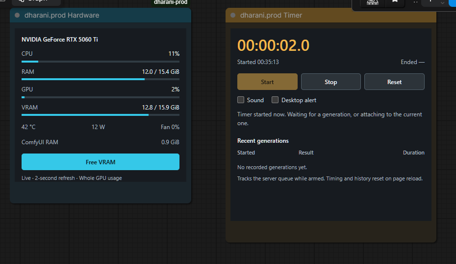
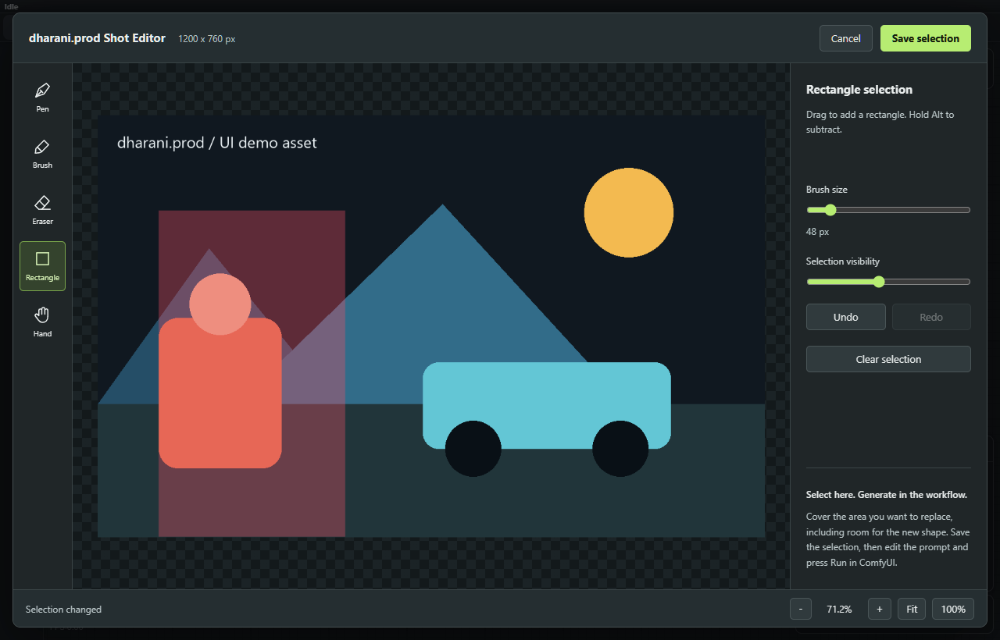

# dharani.prod for ComfyUI

One ComfyUI node suite for monitoring a session, revising a shot, finding visual references, keeping prompt records, and working with local voice tools.



## Why this exists

These tools started as separate production experiments. Installing several folders meant inconsistent names, duplicate node definitions, and scattered setup instructions. This repository brings the authored tools into one package with a consistent `dharani.prod` interface.

The hardware panel uses **cyan** accents; the timer uses **amber**. Both use a dark neutral background, readable status text, and distinct error states. Existing workflow node IDs are preserved so a branding change does not break saved graphs.

This suite does not include model weights, personal reference images, voice recordings, saved archives, or client work. Example images and screenshots use demo content.

## Included nodes

There are **22 registered node types in seven components**:

| Component | Nodes | What it does |
|---|---|---|
| System | Hardware; Timer | Live CPU/RAM/GPU/VRAM readings, idle-only VRAM cleanup, queue timing and completion alerts. |
| Shot Revision | Shot Editor; Prepare Shot Revision; Apply Shot Revision; Revision Difference | Brush/pen/rectangle selection, masks, masked compositing, and measurement of changes outside the allowed region. |
| Keyframe | Reference Browser; Control Panel; Scene Prompt and Adapter; Routed Sampler; Map Preview | Browse movie frames, extract maps, and route to a matching installed spatial adapter. |
| Keyframe compatibility | Reference Controls; Pose Control LoRA | Older V2/V3 node IDs retained for existing workflows. |
| Prompt Archive | Prompt Archive | Save previews, prompt/settings and workflow records to DOCX; browse records and review settings before restoring them. |
| H3 Prompting | H3 Reference Tags | Turn your reference labels into `@image1`, `@image2`, etc. It does not inspect or describe images. |
| Voice | Voice; Voice Line; Voice Director; Voice Select; Voice Session; Voice FX | Local speech bridge, structured takes and selection, reopening sessions, and CPU audio effects. Speech generation needs an external runtime. |
| Kitten TTS | Kitten TTS Clone | Bridge to a separately installed local Kitten TTS 2 runtime. |

All visible names start with **dharani.prod**. Legacy internal IDs such as `VallpaperHardware` remain intentionally unchanged for compatibility; they are not a separate installation.

## Screenshots

### Hardware and Timer

Live hardware readings and the timer panel, captured from the running suite—not a design mockup.


### Shot selection

The editor uses a generated geometric demo image. Your own images stay in your ComfyUI input/output folders.



## Install

Use the Python environment that runs **your ComfyUI**. Do not install a second copy of PyTorch for this suite.

```powershell
Set-Location C:\ComfyUI\custom_nodes
git clone https://github.com/dharaniVibeDev/ComfyUI-dharani-prod.git
& C:\ComfyUI\.venv\Scripts\python.exe -m pip install -r .\ComfyUI-dharani-prod\requirements.txt
```

On Linux/macOS, clone into the same `custom_nodes` directory and run the requirements command with the active ComfyUI environment's `python`.

Restart ComfyUI and refresh its browser page. Search the node library for **dharani.prod**. Then check registration:

```powershell
& C:\ComfyUI\.venv\Scripts\python.exe C:\ComfyUI\custom_nodes\ComfyUI-dharani-prod\scripts\doctor.py --url http://127.0.0.1:8188
```

The health report should show 22 nodes, no missing node IDs, and no failed components. The package is installed from Git; no Comfy Registry registration is claimed.

### Upgrading from the separate local packs

Do not load the legacy folders and the suite together: they register the same node IDs and HTTP routes. The migration script moves old folders into a timestamped backup under `ComfyUI/user/dharani-prod-migration`. It never deletes their contents or changes saved workflows, models, inputs, or outputs.

First review the plan:

```powershell
& C:\ComfyUI\.venv\Scripts\python.exe .\ComfyUI-dharani-prod\scripts\migrate_legacy.py --comfy-root C:\ComfyUI
```

When ComfyUI is idle and stopped, apply it:

```powershell
& C:\ComfyUI\.venv\Scripts\python.exe .\ComfyUI-dharani-prod\scripts\migrate_legacy.py --comfy-root C:\ComfyUI --apply
```

The script prints a manifest path. To roll back, disable this suite, run the script with `--restore <manifest.json> --apply`, then restart ComfyUI. A restore refuses to overwrite a pack that already exists.

### Optional features and dependencies

| Feature | Additional setup |
|---|---|
| Hardware / Timer | `psutil`; NVIDIA GPU metrics use `nvidia-smi`. Missing NVIDIA tools do not remove CPU/RAM readings. |
| Shot Editor / H3 Tags | ComfyUI runtime and its usual image dependencies. No model download is needed for editing masks or formatting tags. |
| Prompt Archive | `python-docx`, Pillow, NumPy and PyAV for video previews. Core requirements cover the additional libraries. |
| Keyframe generation | Native Krea 2 support, a compatible base model, text encoder, VAE, and the adapter/preprocessor packs listed below. Browser search itself does not require those model weights. |
| Voice FX | NumPy and SciPy; CPU algorithmic processing, no speech model. |
| Voice generation | Separate IndexTTS 2.5 runtime and weights. `DHARANI_PROD_TTS_HOME` sets its root; the legacy `VALLPAPER_TTS_HOME` is also accepted. |
| Kitten TTS generation | Separate Kitten TTS 2 runtime and weights. Set `DHARANI_PROD_KITTEN_HOME` to its root. |

The speech bridges currently expect Windows runtime layouts (`.venv/Scripts/python.exe` for IndexTTS and `.venv2/Scripts/python.exe` for Kitten). Their wrappers can register without a speech model, but generation is unavailable until that runtime is configured. Do not install speech-model dependencies into ComfyUI just to make the node appear.

## Keyframe setup and use

The [agent setup prompt](AGENT_SETUP.md) guides dependency checks and model setup. `scripts/setup_keyframes.py` can install pinned adapter node packs or download the listed control/preprocessor weights with explicit flags. **It does not download a large base model or accept model licenses for you.**

External integrations used by the keyframe path:

- [ControlNet Aux](https://github.com/comfyorg/comfyui-controlnet-aux): DWPose, Depth Anything V2, Canny, and lineart extraction.
- [Krea 2 Ostris Edit](https://github.com/ostris/ComfyUI-Krea2-Ostris-Edit): pose/lineart reference conditioning.
- [Native Krea2 Control](https://github.com/facok/comfyui-krea2-controlnet): expanded-projection depth conditioning.
- [NK2E](https://github.com/Nynxz/ComfyUI-NK2E): Canny in-context conditioning.
- [rgthree](https://github.com/rgthree/rgthree-comfy): the example workflow's optional style-LoRA stack.

The tested baseline is **ComfyUI 0.42.1**. Older versions without native Krea 2 and the current `comfy_api.latest` interfaces are not a supported full-suite target. Run `doctor.py --keyframes` to check the exact external node classes, in addition to the suite's own registration. The setup manifest pins the tested adapter-pack revisions; it does not establish compatibility with arbitrary future updates. Model entries marked `other` or without a declared license require checking their source terms; a successful download is not a commercial-use permission.

1. Load the unified example from `examples/workflows`.
2. Select your installed Krea Turbo model, text encoder, and VAE.
3. In **Reference Browser**, upload an image or click **Browse Movie Frames**. Search a movie, select a thumbnail, and click **Use selected frame**.
4. Turn on one map. `generation_control = auto (one enabled)` chooses its adapter.
5. Inspect the fixed map preview, enter the scene prompt, and generate.

The packaged geometric image is for UI/mask demonstrations, not a generation-quality benchmark. To make its example filename available, run `python scripts/install_demo.py --comfy-root <your ComfyUI root>`, or upload your own reference instead. The script refuses to overwrite a different existing input file.

**Multiple map switches do not mean simultaneous multi-adapter generation.** Several maps may be enabled for preview, but you must explicitly choose the single generation adapter. Ambiguous selection stops generation; unsupported combinations are not silently stacked. All switches off gives prompt-only generation.

The scene prompt is passed unchanged. The backend restores the shared base model before assembling a new adapter, and uses tested mode defaults unless steps are overridden: pose 10 Euler; depth/Canny 8 Euler; lineart 8 Euler ancestral; simple scheduler, CFG 1, denoise 1.

Write prompts around **subject + action + environment + lighting** and keep the camera instruction consistent with the reference. A depth map does not specify body joints, identity, transparent glass, or exact lens geometry. Strong edge guidance can retain source objects when the prompt requests a different object category. Clean execution is not evidence of perfect prompt adherence.

## Prompt Archive

Connect an IMAGE, supported VIDEO, video output filenames, or an existing local video path to **dharani.prod Prompt Archive**. The tool saves previews and records into the chosen subfolder of `ComfyUI/output`. Use the library browser to inspect saved work. Settings restoration presents a comparison rather than applying an unrelated graph blindly.

## Agent-assisted installation

Copy [AGENT_SETUP.md](AGENT_SETUP.md) into your coding agent. Fill in your ComfyUI location and the features you want. It includes environment detection, legacy-folder migration, optional dependency/model setup, and verification steps.

## Validation and limits

- Developed on Windows, Python 3.13 and ComfyUI 0.42.1. Latest ComfyUI APIs/native Krea support are required for the full keyframe feature set.
- The migration dry-run/apply/restore behavior and routing policy have automated tests. Hardware/timer tests cover parsing and queue timing.
- Hardware, timer, editor, archive UI and node registration are checked in a running ComfyUI instance.
- Prior local keyframe samples exercised each adapter on a 16 GB RTX 5060 Ti. That does not establish reliability for every edit or reference.
- Exact character/environment preservation, simultaneous multi-adapter guidance, physical camera calibration, and guaranteed cinematic prompt adherence are not established capabilities.
- A node can register while its optional model runtime is absent. `doctor.py` verifies registration, not successful speech synthesis or generation quality.

## Credits and licenses

Authored suite code is MIT-licensed. Original license files for the consolidated hardware and voice components are retained. Model weights and external integrations retain their own licenses; this repository does not grant rights to them or bundle them.

Sources used by optional integrations include [ComfyUI](https://github.com/Comfy-Org/ComfyUI), [Krea 2](https://github.com/krea-ai/krea-2), [thedeoxen's pose adapter](https://huggingface.co/thedeoxen/Krea-2-pose-controlnet), [Patil's depth adapter](https://huggingface.co/Patil/Krea-2-depth-controlnet), [NK2E](https://huggingface.co/nynxz/NK2E), [Cierpliwy's lineart adapter](https://huggingface.co/Cierpliwy/krea2_lineart_edit), [IndexTTS](https://github.com/index-tts/index-tts), [T8's integration](https://github.com/T8mars/comfyui-indextts25-t8), [Kitten TTS](https://github.com/KittenML/KittenTTS), and [FilmGrab](https://film-grab.com). Film-frame source links are retained; film stills are not included in this repository.

The separate [krea2-anypaint](https://github.com/alexw5702-afk/krea2-anypaint) pack is third-party software and is **not rebranded or bundled** here. Its three nodes are not part of this suite's 22-node count.
